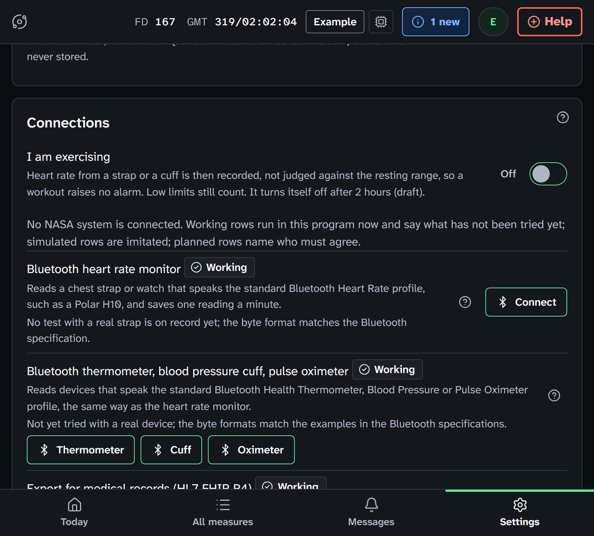

# Crew Health Console

Crew Health Console gathers an astronaut's health readings in one program that runs with no internet, judges them by plain automation against cited norms and red limits, and tells the astronaut in one dated sentence how body and mind are doing, why, and what to do.

Team Just For Fun (Kyiv), NASA Space Apps Challenge 2026, challenge "Create Health Monitoring Software for Astronauts on Space Missions".
This is a hackathon prototype. It is not a medical device, and NASA has not reviewed, approved, endorsed or used it. NASA appears here only as a source of standards and data.

## Links

| What | Where |
|---|---|
| Crew screen (public copy) | https://neveleren.github.io/space-apps-2026-crew-health/ |
| Technical view | https://neveleren.github.io/space-apps-2026-crew-health/machine.html |
| Code | https://github.com/neveleren/space-apps-2026-crew-health |
| Demo video | [presentation/demo.mp4](presentation/demo.mp4) |
| Slides (7) | [presentation/index.html](presentation/index.html), shown at https://neveleren.github.io/space-apps-2026-crew-health/presentation/; also as [presentation/slides.pdf](presentation/slides.pdf) |

- The public copy runs without our server: what you enter stays in your own browser, and the server's protections do not apply there.
- The four example crew members and all their readings are made up and marked as example data. The four Inspiration4 participants are real: their de-identified blood tests come from NASA OSDR.
- The demo video shows the app with English captions and a visible SI mark that names Claude.

## The problem, in NASA's own words

> "On long missions, astronauts carry much of the responsibility for spotting these changes in themselves."

The challenge statement, [NASA Space Apps Challenge 2026](https://www.spaceappschallenge.org/2026/challenges/health-monitoring-software/).

> "Currently data is spread across many systems and often requires cumbersome transfer and packaging; crew often cannot access this data."
>
> "Exploration mission communication delays necessitate a paradigm shift from ground to onboard."

NASA's Crew Health and Performance Integrated Data System Platform project (CHP-IDSP), Aerospace Medical Association meeting 2025, slide "Background" ([NTRS PDF](https://ntrs.nasa.gov/api/citations/20250004859/downloads/CHP-IDSP_AsMA%202025.pdf)).

> "h. Assessing, recording, monitoring, and trending vital signs and additional physiological and behavioral health signs."
>
> "t. Means of providing autonomous medical care and advanced life support."

Two of the in-mission capabilities that every program must provide under NASA-STD-3001 Volume 1 Rev C, requirement [V1 3004] ([PDF](https://www.nasa.gov/wp-content/uploads/2023/11/nasa-std-3001-vol-1-rev-c-with-signature.pdf)).

Our answer: one place for the crew's readings that the crew can see themselves (the Medical record screen shows everything the program holds about a person, like a patient's medical card); judgement on board by automation that needs no link and no AI; a message for the doctor that waits, sealed, in an outbox for the downlink (the downlink itself is not part of this prototype).

## What the astronaut sees

These screenshots show the crew screen with the made-up example flight. The app's code was generated with SI (Claude) from the team's design.

**1. Today.** Sign in as one of four made-up crew members (each can set a PIN) or one of four real Inspiration4 participants.


- One dated sentence about body and mind, for example "As of 15 Nov 2026, your physical condition needs attention, your mental condition is excellent." When something needs the person, level chips, the reasons and the buttons Details, Analyse with AI and Message the doctor appear under it.
- A daily check-in (mood; energy as one of seven statements of the Samn-Perelli fatigue scale, from "fully alert" to "completely exhausted"; sleep quality; and an optional private "What is weighing on you?"), a quick symptom log and a two-tap medicine log from an ISS kit list. A headache logged in the last 24 hours shows the cabin CO2 before it: the latest reading and the 7-day average, against NASA's limit of 3 mmHg as a one-hour average.
- The weekly summary and "Message the doctor" hold the numbers, the check-ins with the sleep ratings, exercise minutes, reaction tests against the person's own runs, the eye self-check answers and the OCT change, then the private symptom and medicine logs with every kit list finding, under a heading of their own. The person sees and edits every word, and nothing is sent unless they press Send.
- Coming up first lists the critical tasks of the next 14 days: with the example flight three made-up ones (a spacewalk for Tom and Elly, a robotic arm session, a docking), otherwise the crew's own, typed in Settings with their GMT date and start. Then, with the example flight (an example schedule), the next three of: the weekly private medical conference (with "Prepare", a drafted 7-day summary the person edits), the talk with the psychologist every two weeks, the monthly thinking test and the next eye check. The card also names the next event of the example mission calendar.
- Before a critical task, from 24 hours before its start (a draft), a readiness card puts together what the app holds about the person: last night's sleep (6 hours or less is a short night, a draft after an ISS study, Jones et al., Sleep 2022), the medicines that can make a person sleepy (the kit list's sleep medicines and those with its note "May cause sedation and impair performance."; zolpidem's FDA label asks for at least 8 hours before work that needs full alertness) and the 3-minute reaction test against the person's own runs. After a short night or one of these medicines it asks for the 3-minute test until one is taken (the 30-second demo does not count), with a button to take it now. "Tell the flight surgeon" drafts a message the person edits and sends. The card is never more than attention and never stops the task.
- From 30 days before landing (a draft), "Getting ready for landing": aerobic capacity and strength against NASA's 80% of the pre-flight level, with the straight line to the landing day (on 15 Nov 2026 the example's line for Elly crosses 80% around 6 Dec, before the 10 Dec landing; the example's dates follow the calendar); the exercise minutes of the last 4 weeks; the eye exam 30 days before return; and what to expect on return, from NASA's sources. After landing, "Back on Earth" counts the R+ days, keeps the check-in and the sleep log going, and shows recovery against the pre-flight level instead of a forecast.
- With the example flight off and no mission set, Today says what is missing, and no example date drives a chart or a forecast.
- A status line that never scrolls away: flight day, GMT clock, a Systems tag (automation, AI, mission, link, doctor, saving, sound), Messages, and a Help key you hold for 2 s (a single press from a screen reader or a switch asks "Call for help now?"). A crewmate's alarm line appears in it.

**2. A "?" on cards, rows and tags.**

- For every measure: what it is, which device measures it on the ISS (with links), how the value reaches the program, and how this value was measured.
- Each measure has its own page: the level, "What to do" steps with check boxes when there is an alert, a chart with periods and custom dates, the normal band, a forecast to landing where one applies, a table view, the norm and the red limits with their sources, and a form to log a reading by hand (with plausibility limits).
- Eyes: a self-check with an Amsler grid and one-tap answers; OCT retinal thickness charted against NASA's 20 micrometre line for the earliest sign of SANS, with 55 micrometres or more as a red limit at "needs action" (both drafts).
- Hearing is judged by its shift from the person's own latest test before launch; body mass is charted with lines at a loss of 5% and of 10%; the cabin CO2 page shows the 7-day average; the symptom page lists the latest headaches with the cabin CO2 before each (see "How it decides").

**3. Mind support.**


- The AI support offer in the team's own words. It can name a topic the person marked on 3 or more of the last 7 days (a placeholder rule). The choice: "Start an anonymous session with AI" or "Tell the doctor on Earth".
- The session panel holds a privacy card, "Help now", short coping steps by topic, a write-it-out box that is not saved, "Tell the doctor on Earth", and now a chat with a small open AI model that runs on this computer, after the person agrees (see [The local AI](#the-local-ai)). With the AI off, or when this browser cannot run it, the rest of the panel works the same.
- "Help now" leads to a person: talk to a crewmate now, request a private call with the ground (the request is shown before it is sent), or open my plan. It also opens by itself when risk words are typed in any box of the mind tools. The word list is a plain draft list, not AI, and nothing is sent by itself.
- Tools that work with the AI off: small things that help (each with its source), a private journal with a letter to the psychologist, my plan for hard days, five-step problem solving, a 3-minute Earth break with six real scenes (rain on a forest trail, a wheat field, a city, a cafe, the sea, a forest), each a video loop with its own sound, a 3-minute reaction test.

**4. Settings and connections.**



- Every connection says Working, Simulated or Planned, with its sources.
- Sound and display (a sound test; light, the default, dark or follow the device; a sun or moon key in the status line switches light and dark in one press), mission profile (ISS, Moon, Mars: the signal delay), camera, "I am exercising" (turns itself off after 2 hours, draft), save a copy of your data and bring it back, the PIN, and the simulation switches.

**5. Medical record.** The fifth key ("Record" on phones) opens everything the program holds about the signed-in person in one place, read only, like the patient's medical card that the Helsi app shows from Ukraine's national e-health system.

- A card with who it is (made-up or real), the mission and flight day, and where the record is kept; today's sentence and alerts; a list of the sections with their counts.
- The sections, newest first: vital signs and other measures (latest value, time, source, count), lab results (the real Inspiration4 draws, each value against its lab range), eye checks, images and tracings, medicines taken and symptoms (private), alerts and what happened to them (the red limit, the crew line, the message to the doctor, false alarms, all clears), messages to the doctor, the mind and the cycle (private), and documents (the FHIR export, a copy of everything, print or save as PDF).
- Every item opens where it came from: the measure's page, the blood value, Messages, the cycle card.
- Allergies, vaccinations, diagnoses, prescriptions, procedures and visits are listed as "Not in this prototype: comes from the medical record system", pointing to the planned NASA medical record row. The HL7 International Patient Summary asks its required sections (allergies, problems, medicines) to say why when they hold no data; the record does the same for all six.
- Only the person's own records; a crewmate's screen never gets them.

**6. The menstrual cycle log** (on All measures, and "Cycle log" on Today; private to the person).

- A month calendar: press a day to log its bleeding (no bleeding, spotting, light, medium or heavy, the four kinds ACOG asks people to note on a calendar) and symptoms from a sourced list (cramps, headache, back pain, bloating, tender breasts, acne or skin problems, nausea, tiredness, constipation or diarrhea, large clots). Today and the 89 days before can be logged or changed (a draft), never a day still to come. Each day is drawn with marks of different shapes and says in words what was logged; there is no red on it.
- The summary and the history: the cycle day, the periods with their length and cycle length, the plain averages of the last cycles and the estimated next period ("a plain average, not a medical model"), and the ACOG and Endocrine Society flags, plus a draft flag for spotting apart from periods.
- Periods suppressed with hormones, as many astronauts choose: no estimate and no flags; the log asks about breakthrough bleeding instead and counts it over the last 90 days, in the words of 2022 recommendations for describing bleeding on hormonal methods (Creinin and others, Contraception). On the ISS this matters: the US systems that reclaim water from urine were not designed for menstrual blood (Jain and Wotring, 2016).
- Nothing from it goes by itself into crew lines, doctor messages, the FHIR export or the technical view, which shows only "a private cycle log entry"; the person's own "Save a copy of my data" file holds it. No fertility or ovulation features. The example flight's days of flow and symptoms are made up.

**7. An analog test, for example in NASA's HERA.** The program measures itself (drafts for the team):

- An alert log: when an alert shows, is acknowledged (Mark as read, Mark all as read, the Messages key, Silence, Silence all sounds), clears or is called off as a false alarm, that step is saved in the person's own record, one entry per alert and step and no text. With the station server, every screen where the person is signed in then shows the same read state, and an acknowledged alarm stops sounding on the others at their next look (15 s). Each message says when it was acknowledged, how, and how many seconds after it showed.
- A Drill switch in Settings: the screen says DRILL, everything new is marked as the drill's, alarms sound and reach the crew and the doctor as usual with the word DRILL, and drill readings never count in the levels, the charts, the summaries for the doctor or the FHIR file. It is off at every sign-in and ends by itself after 60 minutes (a draft).
- After an urgent alarm is acknowledged, an optional workload rating on the Bedford scale, which NASA-STD-3001 Vol 2 names for crew interfaces [V2 5007], in the words of NASA's own figure.
- A study export of all subjects, by id only, with no alert about the mind, the cycle, symptoms or medicines: `node tools/study-export.mjs`, or "Study export" on the technical view.

## Working now, simulated, planned

| Part | Status | Note |
|---|---|---|
| Crew screen: sign-in, Today, check-in, quick logs, all measures, charts, forecast, hand entry, messages | Working | Runs offline |
| Medical record: everything about the person in one place, read only | Working | Allergies, vaccinations, diagnoses, prescriptions, procedures and visits are listed as not in this prototype |
| Levels, red limits, crew alarm lines, alarm tones, Help key | Working | Every threshold is a draft for flight surgeons |
| Mind support tools | Working | Journal and plan stay in this browser, not encrypted |
| Critical tasks, the readiness card before one, getting ready for landing, back on Earth (R+) | Working | Drafts; the example's tasks are made up; the crew's own tasks are typed in Settings, not read from a crew plan |
| Alert log, drill, Bedford rating, study export (analog test) | Working, not yet used in a test with people | Drafts: the drill's 60 minutes, which alarms ask for a rating |
| Camera: a hand on the chest asks "Are you okay?", a sleeping person is ignored | Working, as a demonstration | Google's models run on the computer; no video stored or sent; off after an hour |
| Server: one file per person, per-person reads, checked events, sealed outbox | Working | Uses a public DEMO key |
| Bluetooth heart rate strap, thermometer, blood pressure cuff, pulse oximeter | Working, not yet tried with a real device | Standard Bluetooth profiles; Chrome or Edge |
| CSV import: Hexoskin, Astroskin, Actiware, Svantek, or chosen columns | Working, not yet tried with a real export | Tested with small files written from the makers' documents; the Svantek layout is a guess |
| FHIR R4 export, calendar file (iCalendar) | Working | The FHIR file marks example data with the HTEST test label |
| NASA OSDR Inspiration4 blood tests | Working | A saved copy, offline |
| ISS cabin air (NASA ISSLive), space weather (NOAA) | Working, Earth demos, off by default | Need internet; cabin O2 and space weather are shown, not saved |
| Example flight; device buttons on the technical view | Simulated | Made-up readings, marked as such |
| Link to Earth, doctor on board | Simulated | Switches in Settings. The downlink is not built: messages wait in `data/outbox/` |
| A local AI for "Analyse with AI" and the anonymous session | Working, measured on one laptop | An open model on this computer, after the person agrees; rules in `src/ai-rules.js`; the "AI is working" switch in Settings turns it off; rules only when the browser cannot run it. The machine's own AI route only marks readings; the model answers in the two panels. Which AI flies is the team's decision (TO CONFIRM) |
| Earth break: six real scenes with sound | Working | Pexels videos and Freesound recordings, all in the program, so it runs offline |
| NASA: station server and downlink, HDTN, Chiron medical record, live crew plan, ISS FIT, Crew Active Dosimeter, astronaut archives. ESA: EveryWear. Others: blood analyzers, DICOM images, watch data | Planned | Each needs the partner named in its row |
| Sign-in with roles, encryption at rest, sender verification, TLS | Not built | Listed under "Not protected" in [docs/SECURITY.md](docs/SECURITY.md) |

## How it decides

- **Automation first.** Every reading goes through one machine (`src/engine.js`) and its cell in `src/config.js`, which holds the norm, any red limits and their public sources. Judging a reading or raising an alarm needs no AI.
- **Levels.** Fine, attention (blue), needs action (yellow), urgent (red), and stale data (cyan). The colours mean what NASA-STD-3001 Volume 2 says they mean, and every level also has an icon and a word: colour is never the only cue.
- **Red limits.** One reading past a published limit counts at once. Examples: SpO2 88% or lower is urgent (MedlinePlus); systolic pressure above 180 is urgent (NHLBI); glucose below 54 mg/dL is urgent (ADA), and its first step is ADA's 15-15 rule; 38.0 °C or more needs action (CDC); 35.0 °C or less is urgent (MedlinePlus, NEWS2); cabin pressure below 34.5 kPa is urgent (NASA-STD-3001 Vol 2); a loss of 10% of pre-flight body mass needs action (NASA's nutrition report). All are drafts.
- **Crew alarm.** An urgent red limit, a camera alarm or the Help key alerts the person and the crew on board, and writes a message to the doctor by itself: to the doctor on board, or sealed in the outbox for Earth, where it waits while there is no link.
  - Every crew screen where someone is signed in asks the station computer for new alarm lines every 15 s (a draft), so the line reaches a crewmate's open screen within seconds.
  - An urgent alarm repeats its tone every 4 s and its spoken line every 16 s until someone acknowledges it (drafts). "Sound off" never mutes it.
  - A crewmate sees one line, for example "Tom needs help now: Blood oxygen (SpO2) 85 %.", and nothing else from that record.
  - "I am okay: false alarm" writes an all clear that takes the line away on every screen, and tells the doctor.
  - Under the ISS crew code of conduct (14 CFR 1214.403), other crewmembers may not use or disclose a crewmember's medical information without consent, "except as required for the immediate safety of ISS crewmembers".
- **Analog test.** Each alert's steps (shown, acknowledged, read, cleared, false alarm, workload) are events of the person's own record, never shared with crewmates. A drill's readings go into a second machine used only for the drill's alarms; the machine that judges the person never sees them. A crew line is never marked as a drill while a real urgent sign from before the drill is present; while one is, the line names only the real signs, so a drill's value never shows in a real alarm; and "I am okay: false alarm" on a real alarm during a drill is a real answer: the alarm is called off in the record and its all clear stays real.
- **Expected changes are information.** Changes that flight studies call common show on the measure's page and never raise the headline: a resting temperature up to about 1 °C above the usual range, built up over the first months of flight (Stahn 2017) and always below 38.0 °C; sleep of 5 hours or more (Barger 2014).
- **Watch rule.** A daily vital sign just outside its normal range (inside its red limits) is watched first: attention after 3 readings in a row outside, needs action after 7. Two or more vital signs outside within 24 hours count at once as attention (after NEWS2). Heart rate and breathing rate readings marked as exercise are recorded, not judged against the resting range; their low red limits still count.
- **Forecast.** A straight line to landing. It raises an alert only for slow measures (VO2max, strength, radiation, hearing) or a line that clearly outruns the daily scatter. Body mass is left out: crews lose 2 to 5% in the first month and then keep the lower mass (NASA's nutrition report), so a straight line would overstate the loss. It is not a validated medical model, and the page says so. It needs the mission's dates: with no mission set there is none, and after landing the measure's page shows recovery against the pre-flight level instead.
- **Own pre-flight test.** Hearing (the average at 2000, 3000 and 4000 Hz) is outside the norm at a shift of 10 dB or more from the person's latest test before launch, NASA's criterion for a mission-related shift (NASA JSC, ICES-2015-239); WHO's 20 dB stands in for tests before launch and while no pre-flight test is on record. Body mass, as a share of the person's pre-flight mass: a loss of more than 5% is attention ("worthy of concern"), a loss of 10% or more needs action ("clinically significant"), after NASA's nutrition evidence report (2015). All drafts.
- **Readiness and landing.** Every window and limit of the readiness card (24 hours, a short night of 6 hours or less, which medicines count) and of the landing card (30 days, 4 weeks of exercise) is a draft, marked on screen. The cards decide nothing: they gather what the app holds and offer to tell the flight surgeon.
- **No fresh data.** Then the sentence says "not enough fresh data to judge" instead of "excellent".
- **Mind check-ins.** Low mood or low energy on 6 or more of the last 14 days gives attention, on 8 or more needs action. Low energy is a fatigue answer of 5 ("moderately tired") or more of 7: a draft, the team's open decision; the scale's 1982 report puts the start of moderate fatigue at 5, as a hypothesis. Placeholders until the team chooses a questionnaire.
- **Ship.** Cabin CO2, oxygen, pressure, temperature and noise are compared with NASA limits. A ship alarm reaches every crew screen and points to the ship's procedures. The CO2 page also shows the 7-day average: on the ISS, for each 1 mmHg more CO2 the odds of a reported headache doubled, and a headache risk below 1% needs a 7-day average below 2.5 mmHg (Law et al., 2014; NASA OCHMO-TB-004). A logged headache shows the cabin CO2 before it, as information only.

## Privacy and security

Full detail, including what is not protected: [docs/SECURITY.md](docs/SECURITY.md).

- The crew screen asks the server for one person's records only, plus the ship's cabin readings and crewmates' alarm lines.
- An optional PIN per person: only a PBKDF2-HMAC-SHA256 hash (600,000 iterations, random 16-byte salt) is kept, in this browser. It is a privacy screen, not a lock.
- The server answers only known host names, saves only JSON from its own pages, checks every event against `src/config.js`, never serves `data/`, `tests/`, `tools/`, `demo-keys/` or dot files, and sends security headers with a Content Security Policy. The pages carry the same policy as a meta tag for the static copy.
- Each message to a doctor is sealed in `data/outbox/` for the flight surgeon's public key (ECDH P-256, HKDF-SHA-256, AES-256-GCM). The key pair in `demo-keys/` is a public DEMO key, never a real one.
- Not protected yet: the server has no sign-in or roles (the technical view reads everyone); `data/<id>.jsonl` is plain text; there is no sender verification and no TLS.
- The alert log is the person's own: a crewmate gets only alarm lines, never these steps. The study export names people only by id and leaves out every alert about the mind, the cycle, symptoms or medicines; the command line writes it into `data/study/`, which the server never serves.
- `SBOM.json` (CycloneDX 1.6) lists the 8 third-party components (the camera runtime and its two models, the Lucide icons, the WebLLM engine and the AI model's compiled program, two fonts) with their hashes, and `SHA256SUMS` holds the hashes of their 19 files; `npm test` checks both. The AI model's weights are not in the repository. The Earth break's videos and sounds are credited in `assets/breathe/CREDITS.md`, not in the SBOM. The NASA data are credited below.
- The AI: nothing written to it leaves this computer, and the talk is forgotten when the panel closes. The pages' own policy allows `https://huggingface.co` and `https://*.hf.co` for the public demo's model download only; the server's policy allows no model host, so on board the model comes from the program's folder. The public download is pinned to one revision, and the config, the tokenizer and the compiled program are checked by SHA-256.

## Connections

Full list with sources and the tests run against the real services: [docs/INTEGRATIONS.md](docs/INTEGRATIONS.md).

- No NASA crew health system is connected. NASA's crew health systems have no public interface, so they are Planned rows that name who must agree.
- The two live links are public services on Earth, NASA ISSLive and NOAA's Space Weather Prediction Center. Both are off by default, and the program works the same without them.
- The other working links use open standards: Bluetooth health profiles, HL7 FHIR R4 (LOINC codes, UCUM units, Device and Provenance), iCalendar and CSV. The Inspiration4 blood tests are a saved copy of NASA OSDR data.

## Mind support

Why each tool is there, with its sources and guardrails: [docs/MIND_SUPPORT.md](docs/MIND_SUPPORT.md).

- Built on NASA studies of recent years and on studies of support with AI. Each card names its source and a badge: "used on the ISS", "NASA research" or "study on Earth".
- Private by default, and a person first: "Talk to a person now" sits at the top of the plan for hard days, and the AI session offers "Help now" and "Tell the doctor on Earth". It says plainly that it is a program, never reads emotion from the camera or voice, keeps its signals calm and works offline.
- No questionnaire was added: which one is the team's decision.

## The local AI

New in 1.4.0. "Analyse with AI" explains the readings its panel shows, and the anonymous session is a short talk. Both use one small open model that runs on this computer. Both panels show "Rules this AI follows".

- **It asks first.** Nothing downloads before the person agrees on a card that says what downloads, how big, from where, and that the AI runs on this computer and nothing written to it leaves it.
- **Model and engine.** Qwen2.5-1.5B-Instruct, the 4-bit MLC build at revision 9bd564b0 (Apache-2.0), run by WebLLM 0.2.87 (Apache-2.0, bundled in `vendor/web-llm/` with its licence) over WebGPU. The model's compiled GPU program is bundled too; its licence is TO CONFIRM.
- **What it needs.** Chrome or Edge with WebGPU and shader-f16, a download of 876 MB and about 1.6 GB of graphics memory. On a laptop with two graphics chips the browser must use the high-performance one (Windows Settings, Display, Graphics); the panel says so. TO CONFIRM.
- **On board.** `node tools/fetch-model.mjs` fills `assets/models/` once, and `serve.mjs` serves the model from there, so nothing downloads on the station. The public demo site downloads it from Hugging Face at that fixed revision; the config, the tokenizer and the compiled program are checked by SHA-256, the weight files by the revision. After that the browser keeps the model, and it starts with no network.
- **Measured on the team's laptop** (RTX 3050 Ti, Edge, one laptop only): ready in 4.5 to 7.1 s from the on-board folder; the first answer in 24 to 38 s, which includes compiling for the graphics chip; later answers in 0.8 to 16 s; 15 to 19 tokens per second.
- **Rules in three layers.** Every rule is in `src/ai-rules.js` with its source; the ones that wait for the owner are marked TO CONFIRM.
  1. Before the model: risk words open "Help now" first, and the model never sees that message. Private logs never go in.
  2. The system prompt, built from the rules.
  3. A check of every answer before it is shown: diagnoses, medicine names and doses, claims to be a person or a doctor, ignoring or contradicting the automation's levels and alarms, and putting off action when a reading is red. A held answer becomes a fixed text that names the rule. Only a count is kept.
- **Rules only.** With no WebGPU, no usable graphics chip, a failed download, a chip that lets the model go, or the "AI is working" switch off, the panels show the rules and everything else keeps working.
- **What it never does.** It never sends a message or calls anyone, and it never sets a level, a red limit or a step: those stay the automation's alone.

### How this AI works in space

- It knows where the crew is (ISS, Moon or Mars, from the mission profile). On Mars it never promises a quick answer from Earth: a reply takes at least twice the one-way delay, which reaches about 22 minutes (NASA HRP-48021).
- With no link to Earth, it says that a message to the doctor waits in the outbox until the link is back. It never tells the person to contact Earth now.
- When Earth is far or the link is down, it points first to the crew medical officer and the crewmates on board, then to the doctor on Earth (NASA-STD-3001 Vol 1 [V1 3004], [V1 3006]).
- It does not talk about itself as a person and claims no feelings (NASA-STD-3001 Vol 2 Appendix F.6.2). The support offer keeps its own first-person words ("Hey <name>, I noticed ..."): the owner kept them on 15 Nov 2026.
- Its mode shows in the status line (loading, rules only, off), with a short notice when the mode changes ([V2 10161], [V2 10162]).
- There is no internet on board, so the whole AI runs on this computer.
- It opens only when the crew asks [V2 10169].
- It can be switched off, and the automation works without it [V2 10165], [V2 10168].
- It never acts on its own [V2 10164].
- It explains its reason and says when a question is beyond it [V2 10170], [V2 10171].
- It is a small model and reads text only. The ISS laptop is the HP ZBook Fury G9; its flown graphics chip is not confirmed.
- The talk is private and does not leave this computer [V1 6003], [V2 10125].

## NASA requirements

The full traceability matrix, with the evidence for each row: [docs/REQUIREMENTS.md](docs/REQUIREMENTS.md).

- **Display, met in part:** the crew screen follows the Display Standard of NASA-STD-3001 Vol 2 Rev F, Appendix F [V2 10150], in its colour meanings, an icon and a word on every level, a status line that is always visible, units on values and numbered procedure steps. Gaps, such as no units in the table view's column headers, are listed in the matrix.
- **Alerts, met in part:** a colour, icon and word for every level, and tones after Table 10.3-1 for needs action and urgent [V2 10114]: an urgent alarm repeats until someone acknowledges it, the needs-action tone plays once; the first burst 10 dB below the repeat [V2 10176]; a sound test, but no light test [V2 10117]; stale data marked for measures with an expected cadence [V2 10020]; a Help key held for 2 s, which is on the screen and so not yet independent of the display, as [V2 10178] asks.
- **Records and privacy:** secured handling of medical records [V1 7003] and protection of private data [V2 10125] are met only in part (see SECURITY.md).
- **ISS research software rules** (NASA JSC, [archived page](https://web.archive.org/web/20260312221613/https://tsc.jsc.nasa.gov/roi-swprocess/sw_reqs.html)): "Experiment software does not have internet access on ISS"; installer packages "should contain all dependencies"; "File names shall not contain PII". The program runs with no internet and keeps personal information out of its file names (a person's file is named by id, an outbox message by time and a random number). It has no installer package: the folder holds everything the pages need, but Node.js 18 or newer must be installed.
- **Built for an analog test, not yet used with people:** the alert log with the time to acknowledge, a drill mode [V2 10153], a Bedford workload rating [V2 5007] and a study export by id only ([V2 10163]).
- **Not done:** tests with real people (human-in-the-loop testing, [V2 3101]), the NASA usability score [V2 10001], error rates [V2 10002], a hazard analysis.
- **Software class:** we read it as NPR 7150.2D Class E, which "can include prototypes of flight and ground systems ... in the spirit of 'exploring a design concept'" ([Appendix D](https://nodis3.gsfc.nasa.gov/displayDir.cfm?Internal_ID=N_PR_7150_002D_&page_name=AppendixD)). The same ISS page says "All ROI flown software is assumed to be Class C". NASA sets the class.

## Run it

```
npm start
```

- Then open http://127.0.0.1:8080/ (crew screen) or http://127.0.0.1:8080/machine.html (technical view).
- Needs only Node.js 18 or newer. No packages to install, no build step, no internet. `node serve.mjs` does the same without npm.
- Optional settings: `PORT`, `HOST`, `HOSTS` (more host names to answer), `DATA_DIR`, `OUTBOX_KEY_FILE` (the flight surgeon's public key).
- Saved data: `data/<person id>.jsonl`, one plain file per person, with no personal information in file names. `npm run outbox` opens the queued messages with the DEMO key, as the ground would.
- Study export of an analog test: `node tools/study-export.mjs` writes `data/study/study-alerts.csv` and `data/study/study-subjects.csv` (options: `--data`, `--out`, `--real-only`).
- Everything the pages need is in the folder: fonts, icons, camera models, the AI engine and the Earth break's videos, still frames and sounds.
- The AI model is the one part to add, once, with the internet: `node tools/fetch-model.mjs` puts it (876 MB) into `assets/models/`, and `serve.mjs` serves it from there, so the station needs no download. Without that folder, the download the card offers is blocked by the server's policy and the panel names this command; whether it should say "not installed" first is TO CONFIRM.

## Test it

```
npm test
node tools/sbom.mjs --check
```

- `npm test` runs Node's own test runner over 25 test files: the machine, history, camera rules, levels, cycle, server, store, PIN, supply chain, mind tools and the Earth break, quick logs, cells, connections, pages, crew alarm, screens, the fatigue scale and the AI's rules. The server tests start the real server on a throwaway data folder. The AI tests use a fake model, so they need no graphics chip and no download.
- On 15 Nov 2026 (version 1.4.0): 467 tests: 465 pass, 0 fail, 2 skipped, with Node 24.13.0 (version 1.3.0: 385 tests, 383 pass, 0 fail, 2 skipped). The 2 skipped tests call the real ISSLive and NOAA services.
- We also walk the pages in headless Chromium with Playwright. These scripts are kept outside this repository and are not part of `npm test`. Run on 15 Nov 2026 against commit `09e93ae` (version 1.1.0, the merged review fixes), each on a fresh data folder:

| Browser check | Steps | Result |
|---|---|---|
| The main flows of the crew screen, at 1366 px and at 375 px | 66 | 66 passed |
| Check-in topics, quick logs, mind tools, reaction test, eye check, OCT page (desktop) | 29 | 29 passed |
| PIN, crew alarm line, live feeds, CSV import, calendar and FHIR files | 15 | 15 passed |
| A copy without the server: page policy, fonts, NOAA feed, an Earth photo (that version; 1.4.0 shows videos), technical view | 7 | 7 passed, on the final files served as plain files |
| The review's own alarm checks: false alarm, signs that change, retries, refused messages, saves, sign-out, sound, Help key paths, keys, CSV import, repeats, PIN screen | 15 scripts | all passed; one script was changed to press the new "Send the request" step |

The first three checks showed no page errors. The 1.4.0 features were walked in Edge. The Earth break: by its builder, then in an independent check that passed 77 of 77 steps in Edge and 67 of 67 in Firefox on the merged code. The local AI: by its builder, from the on-board folder, offline and on the integrated graphics chip, then in an independent check that passed after fixes. What each test file covers, and how to run the browser checks: [docs/TESTS.md](docs/TESTS.md).

## Architecture

Full detail: [docs/ARCHITECTURE.md](docs/ARCHITECTURE.md).

1. Two pages in plain JavaScript modules, no framework, no build: the crew screen (`index.html`, `src/crew.js`) and the technical view (`machine.html`, `src/ui.js`).
2. The machine (`src/engine.js`) puts each reading in its cell (`src/config.js`), checks it against the norm and red limits, and records who gets it. The levels (`src/state-levels.js`) turn one person's history into today's sentence. The crew alarm's rules and words (`src/crew-alarm.js`), the search of the measures (`src/find.js`), the crew's own mission dates and critical tasks (`src/mission.js`), the sections of the medical record (`src/medrecord.js`, drawn by `src/record-view.js`), the doctor's drafts (`src/doctor-summary.js`), the words of the hearing, body mass and CO2 rules (`src/nasa-rules.js`), the readiness before a critical task (`src/readiness.js`) and the landing phase (`src/landing.js`) are kept apart from the screen, so they can be tested without a browser; `src/mission-cards.js` draws the readiness and landing cards.
3. Every reading, answer and message is an event. `src/store.js` keeps events on our server or, without it, in the browser; the machine is rebuilt from them each time a page opens.
4. The server (`serve.mjs`, `src/security.js`, Node built-ins only) serves the pages, checks each event, appends it to the person's file and seals messages to a doctor. It never judges a reading.
5. Bluetooth devices (`src/ble.js`), CSV files (`src/csv-import.js`), ISSLive (`src/isslive.js`), the reaction test (`src/reaction-test.js`), the camera (`src/camera.js`, `src/camera-rules.js`) and a letter to the psychologist add events the same way. The FHIR and calendar exports (`src/fhir.js`, `src/ical.js`) read them. The journal, the plan for hard days, the five steps and the Earth break (`src/support.js`, `src/earth-break.js`, its media in `assets/breathe/`) stay in the browser.
6. The analog test: the alert log and the study tables (`src/alert-log.js`), the drill (`src/drill.js`), their parts of the crew screen (`src/analog-view.js`) and the export (`tools/study-export.mjs`).
7. The local AI: the model as plain data (`src/ai-model.js`); the engine's part, with the rules before the model and the check of every answer (`src/ai.js`); the rules themselves (`src/ai-rules.js`); and the AI's part of the two panels (`src/ai-view.js`). The engine is WebLLM in `vendor/web-llm/`. `tools/fetch-model.mjs` fills `assets/models/` for an on-board copy.

## Open decisions of the team

These stay with the team. The thresholds in the program are marked as drafts on screen.

- Which questionnaire for the mind; the level thresholds, including the mind rule (6 and 8 low days in 14), the fatigue step that counts as a low-energy day (5 of 7) and the 3-in-a-row watch rule; whether to use a NEWS2 total score.
- The crisis floor: what the program does in immediate danger. The crew screen says this is the team's decision and that nothing is sent by itself; a draft wording (`crisisNotice()` in `src/support.js`) is not shown on the crew screen.
- The AI's name; "anonymous" or "private" as the word for the session; who gives advice, the automation or the AI.
- Which AI flies (now Qwen2.5-1.5B-Instruct), and the AI's rules marked TO CONFIRM in `src/ai-rules.js`: the risk words, English only, who gives advice, that it never sends or calls, the exception for immediate danger (not built), text only, and that it does not judge the check-ins. Also the computer it needs (WebGPU with shader-f16, about 1.6 GB of graphics memory) and the high-performance chip on laptops with two.
- Anonymity before "Message the doctor"; how the program tells people apart; names for crew members 3 and 4.
- Who analyses X-rays; the default with no doctor on board and no link to Earth.
- Which parts of a full medical card the program should hold itself (allergies, vaccinations, diagnoses, prescriptions, procedures, visits), and which should come only from NASA's medical record; today the Medical record screen lists them as not in this prototype.
- Converting the ISS oxygen value to the inspired value; an ISS-specific cabin pressure limit.
- An upper heart-rate limit during exercise; a resting pulse of 40 for athletes; how long a red reading of a rarely taken measure stays.
- The alarm timings (a look for new crew lines every 15 s, a repeat every 4 s, the spoken line every 16 s, a call for help tried again every 5 s); whether an eye self-check answer other than "no change" is attention or needs action; the symptom score (8 of 10 in 24 hours) that asks to tell the crew medical officer; the 12 hours for two sleep medicines.
- On the public copy, which has no station server, the urgent sentence still says "a doctor has been called", while the message panel says the message is saved on this computer only. The sentence is the team's own wording.
- Who can clear the line "Help was pressed at this computer" (it stays for 24 hours).
- The cycle log's drafts: how far back a day can be logged (90 days); bleeding or spotting days with one free day between them counted as one episode, a period from its first day of bleeding to its last day of bleeding or spotting; the flag for spotting apart from periods; whether bleeding while periods are suppressed should ever reach the flight surgeon by itself (today it never does).

- The three NASA rules added from the review: which hearing test counts as the pre-flight one (here the latest before launch), whether to watch the low tones too (a 2024 NASA poster reports low-tone shifts in 60% of crewmembers tested on orbit, which a 2000 to 4000 Hz average does not show), the body mass levels (attention past a 5% loss, needs action at 10%), and whether a headache with high cabin CO2 should do more than show the numbers. Which private log lines the doctor's drafts hold by default (now all of the last 7 days, under their own heading).
- The readiness card: its 24 hours, the 6-hour short night, which medicines count, whether a slower reaction test or a sleep medicine before a critical task should go further than attention, and whether a spacewalk should also check aerobic capacity against NASA's 32.9 mL/kg/min [V1 4001]. The landing card's 30 days and 4 weeks of exercise. Whether the crew's own critical tasks are everyone's, as now, or each person's.
- For an analog test: how long a drill may run (60 minutes now, with no public source) and whether one screen's drill should reach every crew screen; which alarms ask for a workload rating (urgent ones now) and whether the Bedford limit for answering an alarm is 3 or 6; what counts as acknowledging an alert (now also opening Messages with its key).

## Use of SI

Space Apps calls AI tools Super Intelligence (SI). Its [Project Submission Guide](https://www.spaceappschallenge.org/resources/project-submission-guide/) permits SI as a tool, but says SI "should not be used to (come up with your idea of how to solve the challenge)".

- **The idea, the structure and every decision** belong to the human member of team Just For Fun. The team's notes hold the human member's own sketch of 14 Nov 2026.
- **Claude (Anthropic), an AI system,** generated the program's own code (everything except the third-party files under Credits), the tests and the documents, this README included, drafted the slides and made the demo video. The demo video and the slides carry a visible SI mark.
- Claude also looked up norms, limits and studies in public sources (cited in the code and on screen), made up the example readings and the crew's pre-flight levels (`src/demo-crew.js`, `src/config.js`; the names Tom and Elly and their resting pulse come from the team's own example), drafted the thresholds and rules (marked "draft" on screen), and chose and prepared the Earth break's videos and sounds. They are real footage from Pexels and real recordings from Freesound, not generated; the only changes are cuts, cropping, scaling, levels and encoding (`assets/breathe/CREDITS.md`).
- **An AI model inside the product, new in 1.4.0.** The program now builds in an open AI model, Qwen2.5-1.5B-Instruct by the Qwen team (Alibaba Cloud), Apache-2.0, which runs on this computer in WebLLM. It is a third-party model, not made by the team or by Claude. Claude wrote the rules it follows (`src/ai-rules.js`, each with its source) and the code that checks its answers. The AI explains and talks; the automation, not the AI, judges every reading.
- Every code file (`src/`, `serve.mjs`, `tools/`, `tests/`) says so in its header, and both app pages in a generator meta tag. The open decisions above were not made by SI.

## Credits and licences

| Files | What | Licence or terms |
|---|---|---|
| `fonts/*.woff2` | Atkinson Hyperlegible Next and Mono 2.001 (Braille Institute of America), Latin subset from Google Fonts | SIL Open Font License 1.1: `fonts/OFL-Atkinson-Hyperlegible-Next.txt`, `fonts/OFL-Atkinson-Hyperlegible-Mono.txt` |
| `src/icons.js`, the extra icons in `src/support.js` | Lucide icons (lucide-static 1.66.0), path data copied unchanged | ISC License, with the MIT License for the icons Lucide derived from Feather: `vendor/lucide/LICENSE` |
| `vendor/mediapipe/` | Google MediaPipe Tasks Vision 1.1.1, the pose landmarker lite and face landmarker models | Apache License 2.0: `vendor/mediapipe/LICENSE-Apache-2.0.txt`, `vendor/mediapipe/NOTICE.md` |
| `assets/breathe/` | The Earth break's six scenes: video loops from Pexels with a still frame each, and recordings from Freesound; cut, cropped, scaled and encoded, nothing generated | Videos: the Pexels License. Sounds: Creative Commons 0 (CC0 1.0). Authors and pages: `assets/breathe/CREDITS.md` |
| `vendor/web-llm/` | WebLLM 0.2.87 (MLC), the engine that runs the AI model in the browser; in `libs/`, the model's compiled GPU program from mlc-ai/binary-mlc-llm-libs | Apache License 2.0: `vendor/web-llm/LICENSE`, `vendor/web-llm/NOTICE.md`; the compiled program's repository has no licence file (TO CONFIRM) |
| `assets/models/` (not in the repository; filled by `tools/fetch-model.mjs`) | Qwen2.5-1.5B-Instruct, 4-bit MLC build (mlc-ai/Qwen2.5-1.5B-Instruct-q4f16_1-MLC, revision 9bd564b0), by the Qwen team (Alibaba Cloud) | Apache License 2.0 |
| `src/inspiration4.js` | Inspiration4 blood tests from NASA OSDR: [OSD-575](https://osdr.nasa.gov/bio/repo/data/studies/OSD-575) (metabolic panel) and [OSD-569](https://osdr.nasa.gov/bio/repo/data/studies/OSD-569) (complete blood count), built by `tools/build_inspiration4.py` | Data "provided under NASA's open access policy"; OSDR asks users to cite the data ([OSDR terms](https://science.nasa.gov/reference/osdr-help-terms-and-conditions)) |
| `src/fhir.js` | 13 LOINC codes for the FHIR export, each checked in NLM's LOINC table | This material contains content from LOINC (http://loinc.org). LOINC is copyright © Regenstrief Institute, Inc. and the Logical Observation Identifiers Names and Codes (LOINC) Committee and is available at no cost under the license at http://loinc.org/license. LOINC® is a registered United States trademark of Regenstrief Institute, Inc. |
| `tests/fixtures/` | Saved answers of NASA ISSLive and NOAA SWPC (15 Nov 2026); small CSV files, written from the makers' documents where there are any (the Svantek one is a guessed layout) | Public feeds; the CSV files are made up |

- Live feeds, off by default: NASA ISSLive (through push.lightstreamer.com) and NOAA SWPC JSON. Only the saved test answers above are in the repository.
- The public demo downloads the AI model from Hugging Face only after the person agrees; on board it comes from `assets/models/`.
- Standards and studies are cited by link in the code, on screen and in `docs/`; none of their files is copied here.
- Google's model cards say the camera models are "not intended for human life-critical decisions", so the camera part is a demonstration, not a medical device.

## Licence of the code

Apache License 2.0: see [LICENSE](LICENSE) (also in `package.json`).
